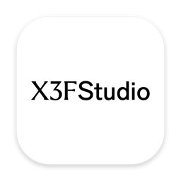
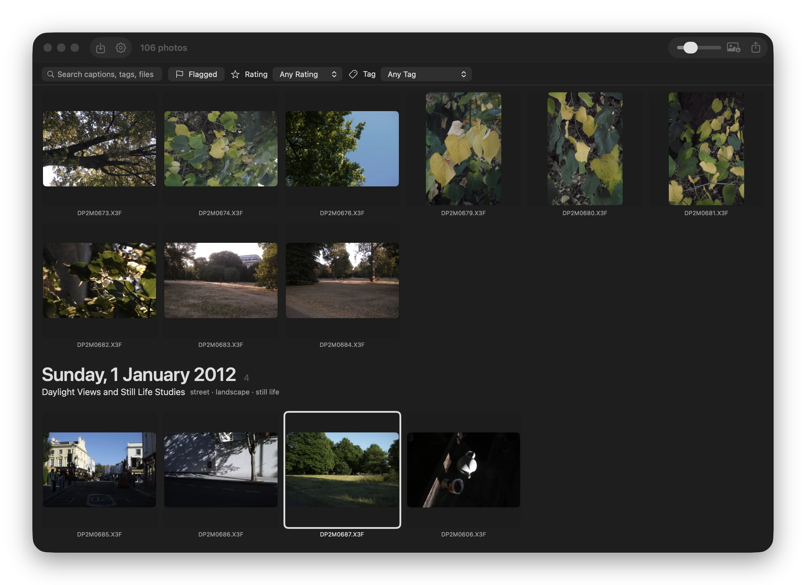

  

<h1 align="center">X3F Studio</h1>

  

A small macOS app for Sigma dp Quattro and Merrill photos: import X3F files (or whole
folders) into a library organised by capture date, adjust them with **SIGMA Photo Pro's own
engines**, and export JPEGs to share.

Every image you see in the editor is rendered by SIGMA Photo Pro 6's own libraries —
`lib95_QuattroDLLForMac.dylib` for dp Quattro files (X3F 4.x) and `lib99_MerillDLLForMac.dylib`
for DP1/DP2/DP3 Merrill and SD1 files (X3F 3.0). The sliders are SPP's X3F adjustments
(Exposure, Contrast, Shadow, Highlight, Saturation, Sharpness, Fill Light, white-balance
preset, colour mode), sent to the engine as `tagAdjustmentParameters`. Nothing is
post-processed in the app.

Requires: Apple silicon Mac, macOS 14+, SIGMA Photo Pro 6 installed in `/Applications`.

## Build

    ./build.sh            # → build/X3F Studio.app   (Command Line Tools only, no Xcode licence needed)
    open "build/X3F Studio.app"

The app is unsigned: first launch with right-click → Open. The icon is pre-rendered in
`assets/AppIcon.icns`; `tools/makeicon.swift` redraws its master from Sigma's web fonts, which
are not included.

## Library layout

Default library: `~/Pictures/X3F Studio` (change it in the Library menu).

    X3F Studio/
      2026/2026-11-07/SDIM0457.X3F     originals, copied on import, by capture date
      Exports/SDIM0457.jpg             "Export JPEG" writes here (full size, EXIF kept)
      .x3fstudio/
        catalog.json                   photos + their settings
        thumbs/ previews/              grid thumbnails and editor placeholders
        renders/<id>/<settings>-v5.tif 16-bit masters (LRU, ~3 GB; -v5 for Quattro, -v4 for Merrill:
                                   the suffix is bumped whenever the default parameters change,
                                   so stale masters age out)
        logs/                          engine server logs

Import skips files already in the library (by content hash and by name+size+date). X3F
files from cameras neither engine develops (the X3F 2.x generation: SD9/SD10/SD14/SD15,
DP1/DP2) are imported and organised too, but show and export the camera's own JPEG.

## How rendering works

`engine/sppqd.c` is a persistent server around both engines (started three times: the editor's
quick renders, the editor's full-quality masters, and background work such as imports and
exports). It picks the engine from the file's raw type and header version;
each engine is loaded on first use. The app talks to it over a tab-separated line protocol:

    render  id=1  in=…X3F  out=…  fmt=rgb8|rgb16|tif  desig=0|5  [w= h=]  exp= con= sha= hil= sat= shp= fill=  wb= cm=
    info    id=2  in=…X3F                      → camera settings, geometry, exposure data
    → ok  id=1  w= h= rot= bpp= ms= engine_ms= engine=quattro|merrill   |   err  id=1  msg=…

Three tiers, all from the engine:

* **Quick** (while dragging): SPP's quick-display designation (0) at its native half size,
  ~0.3–0.9 s once the file is loaded. Its output is 8-bit BGR and carries a vertical chroma
  dot pattern; the server smooths that horizontally for display (`dedot=3`). Other sizes
  alias the pattern badly, so always ask for exactly half.
* **Final** (after ~0.6 s idle, and for export): the 16-bit save designation (5) at full
  size, ~2 s on a loaded file; written as TIFF, cached, shown at full resolution so 100% is
  sharp. Export encodes this TIFF to JPEG with the camera's EXIF.
* The 8-bit save designations (4, 6) scale a fully processed image to any size in ~1.8 s,
  but apply a slightly different tone curve than the 16-bit path (shadows +4–5, highlights
  −3–6 of 255), so they are not used.

Engine facts learnt along the way (see `sppqd.c`):

* The engine keeps per-window stage caches (`MemBridge` / "extra surfaces") that are not
  keyed on the image: a second request on the same file skips the 1.2 s preprocess, but a
  different file would wrongly reuse it. The server calls `finalize`/`initialize` on every
  file switch (instantaneous).
* `P_WIDTH/P_HEIGHT` do not downscale on the save paths (they window the full-res image).
  On the quick path they select the working scale; ≤ half gives exactly the requested size.
* The trim rect is in full-frame coordinates; the camera's aspect crop is applied with it.
* The X3F header's 16-byte "unique identifier" is per camera, not per file.
* Loupe designations (2, 3) need a valid loupe rect or the engine aborts.
* The buffer the engine fills is a complete BMP: a 54-byte file+info header, then the rows
  (top-down, height negative), 24-bit BGR on the display designations and 48-bit RGB on the
  16-bit save path. The server unwraps it; before that, outputs were shifted by 9/18 pixels.
* SPP does not pass every camera-settings tag of the X3F 4.x header on to lib95. Measured in
  SPP 6.9's own parameter blocks: GC (offset 536, header tag 66) is always 0 and the two
  processing-version cells 42/46 are 2/3; both are SPP's own behaviour and the server bakes them
  into every Quattro request (`EngineServer.quattroPokes`). Everything else follows the camera's
  header: X3F Studio does not reproduce the user's saved SPP set (its colour adjustment, or its
  overexposure-correction and noise-reduction choices). The editor's Temperature and Tint sliders
  are SPP's colour grid per photo (cells 228/230/232, `SPPLook.swift`), neutral = the camera's
  colour. With SPP's own cells matched, SPP's review render of a dp2 Quattro file at the grid's
  centre is matched (median 0, 93% of pixels within ±2). The same cells work on the Merrill
  engine (measured 9 Nov 2026 on DP2M0666: per grid unit +0.026/−0.021 stops on the picture's
  mean R/G and B/G along the temperature axis, −0.027/−0.025 along tint, against the model's ±0.03).
* "Less Green", a built-in preset (`Preset.lessGreen`, colour-only: it sets Temperature and Tint and
  leaves the other sliders alone) for Merrill shots that come out greener than the camera's own
  JPEG. Measured 9 Nov 2026 over 72 DP2 Merrill files, comparing the engine's default rendering
  with the JPEG inside each X3F (mean R/G and B/G in linear light): 17 are greener than the
  camera by more than 0.05 stop, the five strongest by 0.15–0.36 stop, and most of the rest are
  slightly less green than the camera. The grid move that brings the five to the camera's balance
  has a median of B 6.5 · M 10; the full match on the strongest (DP2M0666), measured on the
  engine itself with probe renders, is B 10 · M 10. The preset uses B 5 · M 8, most of the way,
  keeping some of SPP's warmth. The green is not a white-balance bug: with WB "Auto" the engine
  already uses the camera's per-shot gains and matrix (`AutoWBGain`, `AutoCCMatrix` in the CAMF),
  and its output has the same colour ratios as SPP 6.9 exports of the same files, so what differs
  is the camera's own JPEG engine. Nothing is applied by itself; the local model's review (off by
  default, Settings ▸ Local Model) proposes the preset's move when it reports a green cast.
* The dp Quattro's highlight pixels: every 16th 2×2 block of every 4th block row (CAMF
  `HighlightPixelsInfo` = origin 0 0, period 16 4, in block units) is a low-sensitivity pixel. Its
  real readings sit in the top plane's extra columns (plane 2 is 6272 wide for the 5888-wide frame;
  block i of a lattice row is at columns 5888+2i and 5888+2i+1 of its two pixel rows) while the
  plane itself holds an interpolated fill at the lattice positions. SPP feeds the engine the real
  readings; with the fill, the engine's highlight gain turned every lattice block into a bright speck
  in the 16-bit masters. The server copies the readings into its input after the fill loop ("-v4").
* Cell 4 of the parameter block is a change mask: SPP sends −1 on the first request for an image
  and afterwards only the bits of what changed (exposure 1<<15, contrast 1<<16, shadow 1<<17,
  highlight 1<<18, saturation 1<<19, sharpness 1<<20, fill light 1<<21, the colour grid
  0xE0000000, a view/size change 3), with cells 8–27 zeroed, and the engine reruns only the stages
  those controls feed (recorded from SPP 6.9 with the shim on a DP2 Merrill file, 10 Nov 2026;
  blocks in `tools/sppcap/captures/2026-11-10-dirtymask`). Measured in `sppqd`: the Quattro
  engine needs the bits — a slider move on a quick render goes from ~120 ms to ~3 ms and a 16-bit
  master following another master of the same image from ~3 s to ~50 ms, output identical — while
  the Merrill engine works the change out by itself (~20 ms for a slider move either way) and,
  given the bits across a change of designation, reuses the quick path's reduced stages for a
  master and returns a different image. The server therefore sends the bits only to the Quattro
  engine and only within one designation (`change_mask`), and the app runs the editor's finals on
  their own engine server (`RenderService.final`) so that consecutive masters of the photo being
  edited stay incremental; quick renders have `interactive`, imports and exports `background`.
  White balance and colour mode have no bit here and start from scratch, which the engine would do
  anyway (its stage-2 cache is keyed on them). What stays expensive: the first render of a photo
  (decode 0.6–0.8 s + 1–1.3 s), every Merrill master (1.3–1.6 s), the first Quattro master (2.2–3 s).
* lib95 (Quattro) writes up to 128 bytes above its entry stack pointer although `requestProcess`
  has only 24 bytes of stack-passed arguments; lib99 writes none (measured 10 Nov 2026 with a
  canary-filled scratch area). Those writes land in the caller's own frame, so whatever the
  compiler kept there got clobbered: after an unrelated edit to `do_render` it was the "write a
  TIFF" flag, and the editor's 16-bit masters came out as headerless pixel dumps (exactly
  width × height × 6 bytes) that ImageIO could not open, leaving the editor on its soft
  third-resolution quick preview. Every engine call now goes through `engine_request()`
  (`engine/engine_call.h`), a trampoline that gives the engine a 4 KB scratch area holding a copy
  of the stack arguments and logs how much of it was written. The app also checks masters: a
  cached master without the TIFF magic is discarded and developed again, a fresh one is checked
  before it replaces the cached file, concurrent requests for the same master share one render
  (two servers once wrote the same `.part` file), and the preview key is recorded only when the
  thumbnail and preview were actually rewritten.
* The engines open their calibration tables (`BData`, `GData`, `DM`, `LensDatabase`) relative
  to the working directory, so the server enters SPP's bundle root (`/Applications/SIGMA_PhotoPro6.app`,
  SPP's own working directory) before loading one.

### The Merrill engine (lib99)

Found by reading SPP's own host and the X3FM Converter's driver, then checked against SPP:

* Same three entry points, same certificate string, same 1008-byte parameter block as lib95.
  lib99 never reads the sensor field (offset 34); the template's 0x14 (the F20 sensor) stays.
* Input is one float `{R, G, B}` triplet per pixel at the full raw size (4928 × 3264 for a DP
  Merrill), the decoded X3F values cast to float, row-major, nothing else.
* `P_WIDTH/P_HEIGHT` must be the active area from CAMF `ActiveImageArea` (4704 × 3136); the
  engine finds and crops that area itself (its log: `ActiveRect 64 36 4768 3172`). The trim
  rect stays zero, as SPP's host leaves it. P_ROTATE stays 1; the app rotates.
* The header's extended data holds the as-shot adjustments (types 1–6 and 10 = the seven
  sliders as floats, 7–9 colour adjust ×32768, 12/13 chroma/luma noise reduction); the
  white-balance and colour-mode names are 32-byte strings at 0x28 and 0x48. SPP writes its
  saved edits into the same table, so a file saved from SPP opens with those values.
* PROP entries feed the exposure data: ISO, FLENGTH, APERTURE (as n/1000), EXPTIME in
  microseconds (offset 76 as µs/1 000 000 and offset 488 as µs/1), EXPCOMP, EXPNET (480, /100).
* SPP's host hands lib99 a lens-profile text (`009_lensprofile.bin`, the DP1 Merrill one, from
  SPP's binary `LensDatabase/Chromatic/1003.lpi`) in a 0x244000-byte buffer at offset 104.
  Chromatic-aberration correction is off (offset 280) in SPP's defaults, and a render without
  the profile is byte-identical, so the DP1M profile is passed for all Merrill bodies for now.
* Switches the host clears before every request: 548 (GPU), 634 (auto), 280 (CA), 536, 736,
  776, 800. P_HILCOR (220) is 1.0.
* Quick path: designation 0 at exactly half the active area (2352 × 1568), 1.4 s, 8-bit BGR,
  no chroma dot pattern (so no `dedot`); asking for the full size makes the engine try
  5162 × 3398 and crash. Final: designation 5, 16-bit, 2.2 s. Loupe designations need
  P_IMGSIZE 1/3/4 (4704 × 3136 / 3264 × 2176 / 2336 × 1568).
* The Merrill engine asks for six memory surfaces (305/185/124/62/31/31 MB) per request.
* Validation: against the camera's own full-size JPEG the median difference is 2/255 with
  the tone within ±2/255 through shadows and midtones; against the Quattro reference the
  same method gives 2/255 versus SPP's export. Colour: the SPP 6.9 exports of DP2M0653 and
  DP2M0648 found on this Mac have the same mean R/G and B/G as our renders to three decimals
  (the exports differ only in exposure), so the Merrill path reproduces SPP's colour.
* With WB "Auto" (code 1) the engine takes the camera's per-shot gains and matrix from the CAMF
  (its log: `WBGain and Matrix from Camfile: 4.42188 2 1.21875` = 2 × `AutoWBGain`), then
  applies `TempGainFact` from the sensor temperature. The camera's own JPEG is nevertheless
  rendered differently by the camera (DP2M0666: the JPEG's B/G is 0.47 stops higher than the
  engine's); see the "Less Green" preset above.
* Colour-space cell 404: 1 → the engine's `ColorSpace2` (sRGB, what both engines log for SPP's
  default), 2 → 3, 3 → 4, 4 → 8, 5 → 11 (ProPhoto, the DNG path).

`engine/010_params.bin` is the 1008-byte parameter template captured from SPP (a DP1 Merrill
session; the Quattro path overrides what differs); `engine/009_lensprofile.bin` the lens
profile text that came with it; `engine/x3f/` is the Kalpanika X3F reader used to decode
the file, unmodified from [Kalpanika/x3f](https://github.com/Kalpanika/x3f) at `e8b48ca`
(BSD-style licence in `engine/x3f/COPYRIGHT.txt`).

`tools/sppcap/` holds the instruments used to record and compare SPP's engine calls. Its two
forwarding shims are generated from SPP's own dylibs by `mkshim.py` and are not checked in;
nothing compiled is.

Not affiliated with SIGMA. SIGMA Photo Pro is SIGMA's; this only calls it.
